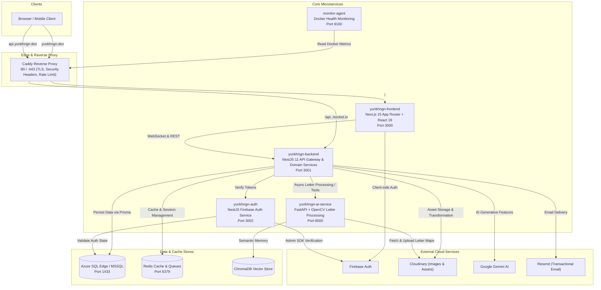

# yunkhngn-website-microservice (Archive)

> Archived monorepo containing the complete microservice architecture for **[yunkhngn.dev](https://yunkhngn.dev)** — a personal portfolio, blog, photography showcase, and interactive handwritten letter platform.

[]()
[]()
[]()

---

## 🏛 System Architecture

The application is decomposed into dedicated microservices communicating over an internal Docker network, reverse-proxied by Caddy with automatic TLS and security filtering.



---

## 📦 Services Breakdown

| Directory | Service | Stack | Description |
|:---|:---|:---|:---|
| [`yunkhngn-frontend`](./yunkhngn-frontend) | **Web Frontend** | Next.js 15, React 19, Tailwind CSS, Radix UI, TipTap, Socket.IO | Public website, interactive portfolio, blog reader/editor, handwritten letter viewer, and admin dashboard. |
| [`yunkhngn-backend`](./yunkhngn-backend) | **Core Backend API** | NestJS 11, TypeScript, Prisma 5, Socket.IO, Swagger | Domain business logic, repository pattern modules (blog, gallery, letters, projects, journal, comments, integrations). |
| [`yunkhngn-ai-service`](./yunkhngn-ai-service) | **AI & Vision Worker** | Python 3.11, FastAPI, OpenCV 4.10, NumPy, ChromaDB | Computer vision pipeline for handwritten letter reveal map generation (CLAHE + dual-threshold Otsu/Adaptive + line band sweep) and LLM agent tooling. |
| [`yunkhngn-auth`](./yunkhngn-auth) | **Auth Service** | NestJS, TypeScript, Firebase Admin SDK, Prisma | Microservice dedicated to token decoding, permission validation, and user profile verification. |
| [`yunkhngn-infra`](./yunkhngn-infra) | **Infrastructure & DevOps** | Docker Compose, Caddy 2, Azure SQL Edge, Redis, Watchtower | Production deployment configuration, Caddy routing rules, DB backup/restore scripts, and container orchestration. |

---

## 📚 Service Highlights

### 1. `yunkhngn-frontend`
- **Modern App Router**: Built with React 19 and Next.js 15 featuring server-side rendering, streaming, and metadata SEO generation.
- **Rich Interactive UI**: Radix UI primitives with Tailwind CSS, Framer Motion transitions, and TipTap rich-text content editing.
- **Real-Time Integration**: Direct Socket.IO client integration for live visitor activity and presence updates.
- **Custom Handwriting Player**: Renders animated stroke reveals based on timing maps computed by the AI vision service.

### 2. `yunkhngn-backend`
- **Modular Clean Architecture**: Feature-scoped NestJS modules with strict interface-driven repository abstractions (`domain/` vs `infrastructure/`).
- **Rich Ecosystem Integrations**: Google Gemini (content & prompt generation), Cloudflare (analytics), Cloudinary (media transformations), Resend (newsletters), and Last.fm (live scrobble tracker).
- **Prisma & MSSQL**: Multi-model schema handling users, blog posts, photo albums with EXIF/blurhash metadata, encrypted system settings, and audit logs.
- **Interactive Documentation**: Swagger UI at `/api/docs`.

### 3. `yunkhngn-ai-service`
- **OpenCV Stroke Decomposition**:
  1. Contrast enhancement via CLAHE (`clipLimit=2.0`, `16x16` tile grid).
  2. Dual-threshold union (Gaussian Adaptive + Otsu) to capture faint ink strokes without background noise.
  3. Text line band detection through horizontal projection analysis.
  4. Generates normalized 8-bit reveal timing maps (values 1–255) for smooth progressive ink reveals on the web frontend.
- **Asynchronous Task Flow**: Returns 202 Accepted immediately and dispatches processing results via webhook callbacks to the backend.

### 4. `yunkhngn-infra`
- **Unified Compose File**: Single `docker-compose.yml` declaring network boundaries, persistent volumes, environment configs, and health dependencies.
- **Production Caddy Reverse Proxy**: Automatic SSL generation via Let's Encrypt, hardened security headers, strict anti-scanner regex filters, and Basic Auth gating for Bull Board queues.
- **Automated Lifecycle**: Watchtower continuous container rolling updates alongside MSSQL automated backup scripts (`scripts/backup.sh`).

---

## 🚀 Running Locally

### Prerequisites
- [Docker](https://www.docker.com/) and Docker Compose
- [Node.js](https://nodejs.org/) 20+
- [Python](https://www.python.org/) 3.11+
- [Yarn](https://yarnpkg.com/) / npm

### Option A: Full Stack with Docker Compose

1. Clone this repository:
   ```bash
   git clone <repo-url>
   cd yunkhngn-website-microservice
   ```

2. Configure environment variables in `yunkhngn-infra`:
   ```bash
   cd yunkhngn-infra
   cp .env.example .env
   cp env-ai.example env-ai       # or configure your Cloudinary/Gemini keys
   cp env-auth.example env-auth
   ```

3. Start services:
   ```bash
   docker compose up -d
   ```

### Option B: Standalone Service Development

Each service can be run independently during local development:

- **Frontend**:
  ```bash
  cd yunkhngn-frontend
  cp .env.example .env.local
  yarn install
  yarn dev  # http://localhost:3000
  ```

- **Backend**:
  ```bash
  cd yunkhngn-backend
  cp .env.example .env
  npm install
  npx prisma generate
  npm run start:dev  # http://localhost:3001
  ```

- **AI Service**:
  ```bash
  cd yunkhngn-ai-service
  python -m venv .venv && source .venv/bin/activate
  pip install -r requirements.txt
  cp .env.example .env
  uvicorn app.main:app --reload --port 8000
  ```

- **Auth Service**:
  ```bash
  cd yunkhngn-auth
  npm install
  npm run start:dev  # http://localhost:3002
  ```

---

## 🗃 Git History & Monorepo Consolidation Note

This repository is a consolidated monorepo created for archiving. Previously, each subfolder was an independent Git repository with its own deployment pipeline:

- `yunkhngn-frontend` (1,075 commits)
- `yunkhngn-backend` (491 commits)
- `yunkhngn-ai-service` (104 commits)
- `yunkhngn-infra` (39 commits)
- `yunkhngn-auth` (2 commits)

All individual histories (>1,700 commits in total), author attributions, commit messages, and file evolutions have been unified into this single repository under their respective directory paths.

---

## 📄 License & Credits

Author: **@yunkhngn**  
Archived for portfolio showcase and reference.
